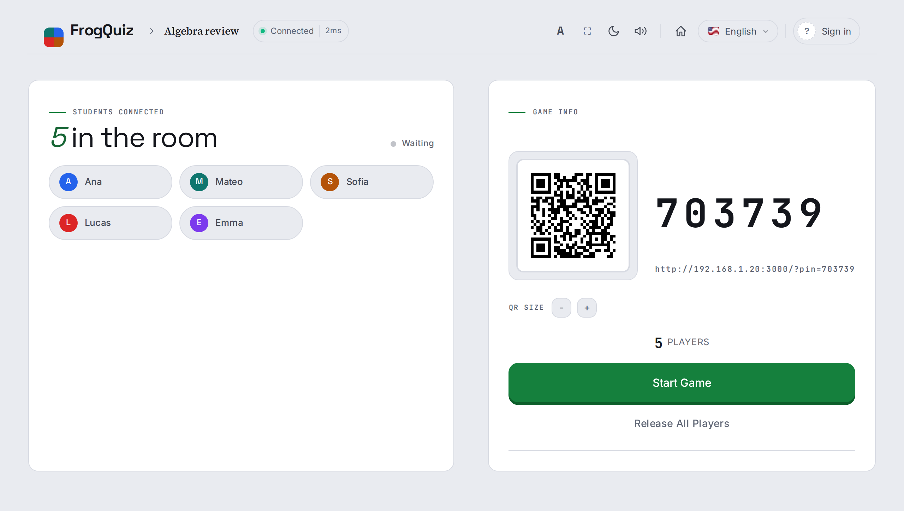
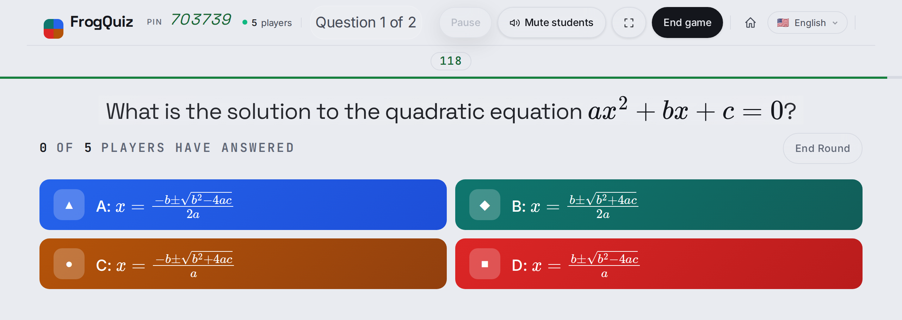
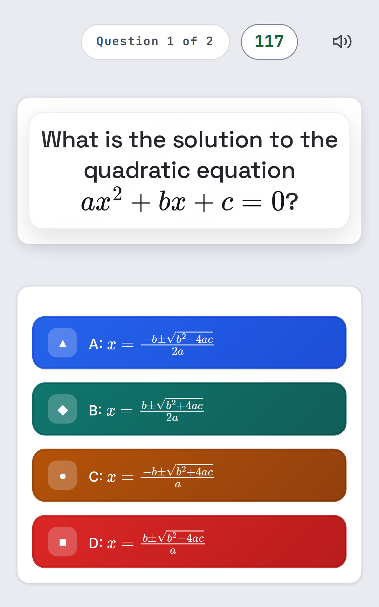

# Quizix Pro

A real-time quiz platform for classrooms and local networks. The host runs a quiz on their
computer, players join from any browser with a PIN, and everyone answers live against a shared
timer and leaderboard. Questions render LaTeX, so it works for maths and engineering material
rather than trivia alone.

Runs entirely on a LAN out of the box. All browser libraries and fonts are served from
`public/libs` (versions and checksums in [public/libs/README.md](public/libs/README.md)), so no CDN
is contacted and the app works with no internet access. Only the AI question-generation features
reach the internet.

| Host lobby: players join by PIN or QR code |
|---|
|  |

| Host screen during a question | Player's phone |
|---|---|
|  |  |

## Quickstart

```bash
npm install
npm start
```

1. Open `http://localhost:3000` on the host computer.
2. Click **Host a Game**, build or load a quiz, then **Start Game** — this shows a PIN and QR code.
3. On any other device on the same network, open `http://<host-IP>:3000`, click **Join Game**, and
   enter the PIN and a name. Scanning the QR code does the same thing.

The server binds to `0.0.0.0:3000`, so anything on the same Wi-Fi can reach the host machine's IP.
Find it with `ipconfig` (Windows) or `ip addr show` (macOS/Linux). Under WSL, set `NETWORK_IP`
explicitly — auto-detection picks the virtual adapter.

## Question types

| Type | Description |
|---|---|
| Multiple choice | One correct answer among several options |
| Multiple correct | Select all that apply; the selected set must match exactly |
| True / False | Binary choice |
| Numeric | Numeric answer with a configurable tolerance |
| Ordering | Drag-and-drop sequence arrangement |

Questions support LaTeX (`$x^2 + y^2 = z^2$`), images, and syntax-highlighted code blocks.
To add a new type, see [docs/ADD-QUESTION-TYPE.md](docs/ADD-QUESTION-TYPE.md).

Consensus mode, where players discuss and vote on one team answer, is experimental: it has not
been used with a real class yet and accepts multiple-choice questions only.

## AI question generation

Quizzes can be generated from a prompt, a pasted URL, or an uploaded PDF, DOCX or PPTX file.

| Provider | Requires | Network |
|---|---|---|
| Claude (Anthropic) | `CLAUDE_API_KEY`, or a key supplied in the UI | Outbound |
| Gemini (Google) | `GEMINI_API_KEY`, or a key supplied in the UI | Outbound |
| Ollama | A local Ollama server and `OLLAMA_ENABLED=true` (or enabled at runtime by a logged-in user) | Local only |

Hosts can paste their own API key in the UI. A key sent with the request is used in preference to
the server-side key, and the server-side key is only spent for logged-in users. Every generation
request is rate-limited per client IP, whichever key it uses. Ollama is the only fully offline
generation path.

## Results and export

Export to CSV, XLSX (Summary / Questions / Players / Wrong Answers sheets), or a formatted PDF
report. Results from repeated runs of the same quiz can be compared side by side, and any question
can be drilled into for its answer and timing distribution.

## Accounts and organization

User accounts are optional. With one, a host can save quizzes into folders; both quizzes and
folders can be password-protected independently of accounts.

## Languages

The interface ships in nine languages — English, Spanish, French, German, Italian, Portuguese,
Polish, Japanese and Chinese — switchable at runtime without a reload. (The screenshots above are
the Spanish UI.)

## Configuration

Environment variables, via `.env` — see [.env.example](.env.example).

| Variable | Purpose | Default |
|---|---|---|
| `NODE_ENV` | `production` also accepts cloud-platform CORS origins (unless `ALLOWED_ORIGINS` is set) and switches the `BASE_PATH` default | unset |
| `PORT` | Server port | `3000` |
| `BASE_PATH` | URL prefix, e.g. for an ingress | `/quizix/` in production, `/` otherwise |
| `NETWORK_IP` | Override the auto-detected LAN IP (needed under WSL) | auto-detected |
| `PUBLIC_ORIGIN` | Public URL used in QR codes and join links behind a proxy or tunnel | unset |
| `ALLOWED_ORIGINS` | Exact CORS allow-list, comma-separated | unset |
| `TRUSTED_PROXY_IPS` | Non-loopback proxy addresses whose `CF-Connecting-IP` is trusted | unset |
| `SESSION_SECRET` | Session secret, at least 32 characters | generated and persisted |
| `ALLOW_SIGNUP` | `true` keeps signup open after the first account exists | unset (closed) |
| `ENABLE_DEBUG_ROUTES` | `true` enables `/metrics` and the debug endpoints; keep unset in production | unset |
| `MOBILE_MODE` | `true` applies the reduced game and player limits in `config/limits.js` | unset |
| `CLAUDE_API_KEY` | Server-side Claude key | unset |
| `CLAUDE_MODEL` | Claude model override | `claude-sonnet-4-5` |
| `GEMINI_API_KEY` | Server-side Gemini key | unset |
| `GEMINI_MODEL` | Gemini model override | `gemini-2.5-flash` |
| `OLLAMA_ENABLED` | `true` enables Ollama generation | unset |
| `OLLAMA_URL` | Ollama server address | `http://localhost:11434` |
| `MANIM_ENABLED` | `true` enables Manim animation rendering, which runs operator-supplied Python | unset |

## Commands

| Command | Purpose |
|---|---|
| `npm start` | Production server |
| `npm run dev` | Auto-restarting dev server |
| `npm run build` | Rebuild the CSS bundle and cache-bust — **required after any CSS change** |
| `npm test` | Unit tests (Jest) |
| `npm run test:stress` | Game-load stress tests (`tests/stress`) |
| `npm run test:visual` | Playwright visual-regression tests |
| `npm run test:coverage` | Tests with a coverage report |
| `npm run lint` | ESLint |
| `npm run format` | Prettier |

## Requirements

Node.js 22.13.0 or later (`engines` in `package.json`), as required by `pdfjs-dist` for PDF
extraction. npm warns on an older Node but still installs.

## Deployment

Built for LAN use. For remote access, put it behind HTTPS with
[Docker](DOCKER.md) ([standalone](DOCKER-STANDALONE.md)),
[Kubernetes](K8S-DEPLOYMENT-QUICK-REFERENCE.md), or a reverse proxy or Cloudflare Tunnel in front
of `npm start`. See [DEPLOYMENT.md](DEPLOYMENT.md) for each, including the variables a tunnel needs
(`NODE_ENV`, `BASE_PATH=/`, `PUBLIC_ORIGIN`, `ALLOWED_ORIGINS`).

Behind a tunnel or proxy, anonymous clients get an empty `/api/active-games` list and cannot
delete, overwrite or rename quizzes that have no owner; signed-in users and direct LAN clients can.
The audit is under "Public exposure via Cloudflare Tunnel" in [docs/FUTURE.md](docs/FUTURE.md).

## Security notes

- Uploads are validated against actual magic bytes, not the claimed MIME type, and stored under
  cryptographically random filenames.
- API keys entered in the browser are encrypted with AES-GCM before being stored.
- AI-generation and upload endpoints are rate-limited per client IP; Socket.IO events are
  rate-limited per connection. Behind Cloudflare the client IP comes from `CF-Connecting-IP`, trusted
  only from loopback or `TRUSTED_PROXY_IPS`.
- Outbound URL fetches re-validate every redirect hop against private and internal IP ranges.

## Documentation

| Topic | Where |
|---|---|
| System design | [docs/ARCHITECTURE.md](docs/ARCHITECTURE.md) |
| REST and Socket.IO API | [docs/API_REFERENCE.md](docs/API_REFERENCE.md) |
| Scoring formula | [docs/SCORING_SYSTEM.md](docs/SCORING_SYSTEM.md) |
| Measured capacity through a tunnel | [docs/CAPACITY.md](docs/CAPACITY.md) |
| Deployment (Docker, Kubernetes, tunnel) | [DEPLOYMENT.md](DEPLOYMENT.md) |
| Adding a question type | [docs/ADD-QUESTION-TYPE.md](docs/ADD-QUESTION-TYPE.md) |
| Known footguns | [docs/GOTCHAS.md](docs/GOTCHAS.md) |
| Roadmap and open TODOs | [docs/FUTURE.md](docs/FUTURE.md) |
| Development conventions | [CLAUDE.md](CLAUDE.md) |

## License

MIT.
